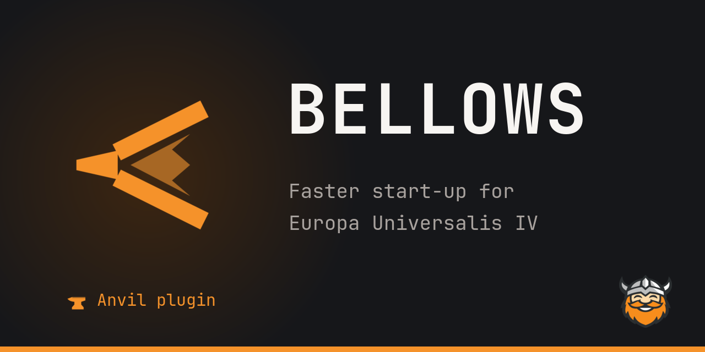

# Social preview

Generates the GitHub social preview image of a team repository (the card that link previews on Discord, Reddit, Slack or X show) in the "dark forge" style of [anvil.happydwarf.dev](https://anvil.happydwarf.dev/) and of the [Workshop thumbnails](../workshop-thumbnail).

The image is 1280×640, GitHub's recommended size, and about 80–95 KB. It shows:
- the project's icon in the accent colour, over a soft forge glow, on the left;
- the name in JetBrains Mono, upper case, with a two-line subtitle below;
- a kicker line at the bottom left (with the small anvil for the Anvil family) and the Happy Dwarf Team logo on the right;
- the accent bar along the bottom.



## Use

Needs Python 3 and ImageMagick 7 (`magick`, with its librsvg SVG renderer). Fonts, the team logo and the anvil mark come from [`../workshop-thumbnail/assets`](../workshop-thumbnail/assets).

```sh
python tools/social-preview/make_social_preview.py \
  --icon ../anvil-website/src/assets/plugins/bellows.svg --name Bellows \
  --subtitle "Faster start-up for" --subtitle "Europa Universalis IV" \
  --kicker "Anvil plugin" --anvil-mark --out bellows.png
```

- **`--icon`:** the project's icon. Anvil plugins use theirs from anvil-website (`src/assets/plugins/<plugin id>.svg`), so the site, the Workshop and GitHub show the same mark. Its `currentColor` becomes the accent `#f5922a`; a background square that fills the icon's whole `viewBox` is dropped.
- **`--name`:** shown in upper case; longer names get a smaller font.
- **`--subtitle`:** one line each, at most two; keep a line under about 30 characters.
- **`--kicker`, `--anvil-mark`:** the accent line at the bottom left. `--anvil-mark` puts the small anvil before it; use it only for Anvil and its plugins.

Upload the result in the repository's **Settings → General → Social preview → Edit → Upload an image**. GitHub has no API for it.

## The team's repositories

Run from the root of this repository, with the other repositories checked out next to it:

| Repository | Arguments |
| --- | --- |
| anvil | `--icon tools/workshop-thumbnail/assets/anvil-mark.svg --name Anvil --subtitle "Plugin loader for" --subtitle "Europa Universalis IV" --kicker anvil.happydwarf.dev --anvil-mark` |
| bellows | `--icon ../anvil-website/src/assets/plugins/bellows.svg --name Bellows --subtitle "Faster start-up for" --subtitle "Europa Universalis IV" --kicker "Anvil plugin" --anvil-mark` |
| tongs | `--icon ../anvil-website/src/assets/plugins/tongs.svg --name Tongs --subtitle "Control Europa Universalis IV" --subtitle "from scripts and agents" --kicker "Anvil plugin" --anvil-mark` |
| anvil-plugin-template | `--icon tools/workshop-thumbnail/assets/anvil-mark.svg --name "Plugin template" --subtitle "Start your own Anvil plugin:" --subtitle "build, CI and releases ready" --kicker Anvil --anvil-mark` |
| anvil-website | `--icon tools/workshop-thumbnail/assets/anvil-mark.svg --name "Anvil website" --subtitle "Install guide, plugin catalog" --subtitle "and docs for plugin authors" --kicker anvil.happydwarf.dev --anvil-mark` |
| etch | `--icon ../etch/packages/extension/media/icon.svg --name Etch --subtitle "Live preview for" --subtitle "EU4 interface mods" --kicker "VS Code extension"` |
| paradox-workshop-publish | `--icon tools/social-preview/assets/pdx-ws.svg --name pdx-ws --subtitle "Publish Paradox game mods" --subtitle "to the Steam Workshop" --kicker paradox-workshop-publish` |
| happydwarf-website | `--icon tools/workshop-thumbnail/assets/happy-dwarf.svg --name "Happy Dwarf Team" --subtitle "Open-source tools and mods" --subtitle "for Europa Universalis IV" --kicker happydwarf.dev` |
| etch-website | `--icon ../etch/packages/extension/media/icon.svg --name "Etch website" --subtitle "Demo, install and roadmap" --subtitle "of the EU4 interface preview" --kicker etch.happydwarf.dev` |

## Assets

- **`assets/pdx-ws.svg`:** the icon of paradox-workshop-publish, which has none of its own: a tray with an upward arrow, in the 32×32 grid and stroke style of the plugin icons.
